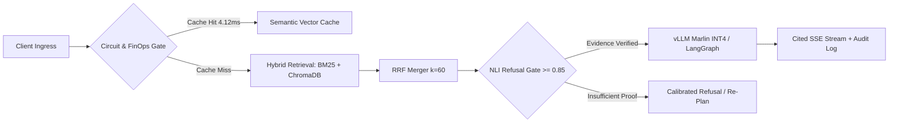

<div align="center">

<!-- HERO WAVE BANNER -->


<!-- ANIMATED TERMINAL SUBTITLE -->
<a href="https://mehedi-hasan-llm.vercel.app/">
  
</a>

<br/>

<!-- PRIMARY NAVIGATION & CONTACT BADGES -->
[](https://mehedi-hasan-llm.vercel.app/)
[](https://www.linkedin.com/)
[](mailto:nafismehedi37@gmail.com)
[](#)

</div>

---

### `01 // ENGINEERING PHILOSOPHY`

I care about what happens **after** the model responds. Deploying AI into production means refusing uncalibrated hallucinations, replacing brittle prompt loops with stateful graph checkpoints, and gating every model promotion behind deterministic CI benchmarks.

```yaml
engineer: Mehedi Hasan
location: Dhaka, Bangladesh (UTC+6)
education: B.Sc. in Computer Science & Engineering @ BRAC University
experience: Software Engineering Intern @ FlyRank | Independent AI Systems Builder
research: 3D Coronary Artery Stenosis Detection & QCA Engine (RASNet / SegResNet · 95.2% CAD-RADS Agreement)
core_focus:
  - Self-Hosted Quantized Inference & FinOps Governance (vLLM, AWQ Marlin INT4, Semantic Caching)
  - Calibrated Hybrid Retrieval & Adversarial Refusal Gates (BM25 + Dense Vector + RRF)
  - Stateful Multi-Agent Orchestration & Durable Checkpointing (LangGraph, PostgreSQL, SSE)
  - Multi-Tenant Security, Cryptographic Audit Ledgers & Offline-First Sync Engines
```

---

### `02 // FLAGSHIP PRODUCTION SYSTEMS`

<table>
  <tr>
    <td width="50%" valign="top">
      <h3>⚡ <a href="https://mehedi-hasan-llm.vercel.app/work/cinch">Cinch</a> — LLM Gateway & Serving</h3>
      <p>14-stage async FastAPI gateway & INT4 Marlin serving platform for Qwen2.5-7B on 8GB VRAM GPUs with Kubernetes HPA and FinOps token cutoffs.</p>
      <ul>
        <li><b>10.86×</b> throughput speedup (<b>331 tok/s</b>) & <b>4.87×</b> lower TTFT</li>
        <li><b>4.12ms</b> semantic cache hits & <b>45ms</b> circuit-breaker fast-fail</li>
        <li><b>195</b> deterministic CI tests + EBNF/AST JSON grammar repair</li>
      </ul>
      <p>
        <a href="https://mehedi-hasan-llm.vercel.app/work/cinch"><code>Case Study ↗</code></a> ·
        <code>Python</code> <code>FastAPI</code> <code>vLLM</code> <code>K8s</code> <code>Prometheus</code>
      </p>
    </td>
    <td width="50%" valign="top">
      <h3>🕸️ <a href="https://github.com/Rytnix786/Nexus">Nexus Researcher</a> — Agentic Workflow</h3>
      <p>Deterministic 8-node LangGraph research engine featuring four-stage retrieval, human-in-the-loop approval gates, and resumable SSE streaming.</p>
      <ul>
        <li><b>8.05 req/s</b> sustained load with PostgreSQL state checkpointing</li>
        <li><b>91%</b> adversarial refusal accuracy on sparse/conflicting evidence</li>
        <li><b>122</b> backend test suites passing with Redis token-bucket rate limiting</li>
      </ul>
      <p>
        <a href="https://github.com/Rytnix786/Nexus"><code>Source ↗</code></a> ·
        <a href="https://mehedi-hasan-llm.vercel.app/work/nexus-researcher"><code>Case Study ↗</code></a> ·
        <code>LangGraph</code> <code>FastAPI</code> <code>PostgreSQL</code> <code>Redis</code>
      </p>
    </td>
  </tr>
  <tr>
    <td width="50%" valign="top">
      <h3>🛡️ <a href="https://github.com/Rytnix786/Ares">ARES</a> — MLOps Promotion Gate</h3>
      <p>Idempotent model regression detection framework evaluating candidate builds against golden sets and live champions directly in CI/CD.</p>
      <ul>
        <li><b>92%+</b> enforced pytest coverage keyed by commit SHA & dataset version</li>
        <li>Configurable F1, latency, and demographic critical-slice gates</li>
        <li>Async SQLAlchemy + PostgreSQL decision trail & Streamlit operator UI</li>
      </ul>
      <p>
        <a href="https://github.com/Rytnix786/Ares"><code>Source ↗</code></a> ·
        <a href="https://mehedi-hasan-llm.vercel.app/work/ares"><code>Case Study ↗</code></a> ·
        <code>Python 3.11</code> <code>SQLAlchemy</code> <code>DVC</code> <code>Docker</code>
      </p>
    </td>
    <td width="50%" valign="top">
      <h3>🧠 <a href="https://mehedi-hasan-llm.vercel.app/work/mindstack">MindStack</a> — Calibrated Hybrid RAG</h3>
      <p>Evidence-first retrieval pipeline combining sparse lexical matching and dense embeddings to eliminate ungrounded synthesis.</p>
      <ul>
        <li><b>95%</b> QA groundedness via Reciprocal Rank Fusion (<code>k = 60</code>)</li>
        <li>Boosted adversarial refusal accuracy from <b>26.7% → 66.7%</b></li>
        <li>Parent-child chunking + pre-generation NLI entailment gate</li>
      </ul>
      <p>
        <a href="https://mehedi-hasan-llm.vercel.app/work/mindstack"><code>Case Study ↗</code></a> ·
        <code>FastAPI</code> <code>ChromaDB</code> <code>BM25</code> <code>Mistral</code> <code>React</code>
      </p>
    </td>
  </tr>
  <tr>
    <td width="50%" valign="top">
      <h3>🔐 <a href="https://mehedi-hasan-llm.vercel.app/work/offboarder">OFFBoarder</a> — Zero-Trust SaaS</h3>
      <p>Multi-tenant enterprise offboarding platform automating access revocation with strict database-level isolation and tamper-proof security ledgers.</p>
      <ul>
        <li>PostgreSQL RLS session isolation + Segregation of Duties (Creator ≠ Approver)</li>
        <li>Chained <b>SHA-256</b> cryptographic audit logs & transactional outbox retries</li>
      </ul>
      <p>
        <a href="https://mehedi-hasan-llm.vercel.app/work/offboarder"><code>Case Study ↗</code></a> ·
        <code>Next.js</code> <code>TypeScript</code> <code>Prisma</code> <code>PostgreSQL</code> <code>Supabase</code>
      </p>
    </td>
    <td width="50%" valign="top">
      <h3>🏥 <a href="https://mehedi-hasan-llm.vercel.app/work/masheba-ai">MaSheba AI</a> — Offline-First Clinical Sync</h3>
      <p>Bangla maternal healthcare & triage platform engineered for rural community health workers operating in zero-connectivity zones.</p>
      <ul>
        <li>Local SQLite outbox queue with microsecond logical-clock conflict resolution</li>
        <li>Resumable byte-offset media uploads & Bangla NLP clinical triage</li>
      </ul>
      <p>
        <a href="https://mehedi-hasan-llm.vercel.app/work/masheba-ai"><code>Case Study ↗</code></a> ·
        <code>React Native</code> <code>Expo</code> <code>SQLite</code> <code>FastAPI</code> <code>Supabase</code>
      </p>
    </td>
  </tr>
</table>

> **Systems & Kernel Foundations:** Also engineered **3D CCTA Stenosis Quantification** (`RASNet` + `SegResNet` 4-stage 3D encoder across clinical cardiac scans), **SimpleFS** (custom C file system with superblocks & inode tables), and a **RISC-V xv6 Lottery Scheduler** inside the OS kernel.

---

### `03 // REFERENCE ARCHITECTURE`

How my production AI pipelines enforce deterministic quality boundaries before a single token streams to the client:



---

### `04 // PRODUCTION STACK`

<div align="center">

<picture>
  <source media="(prefers-color-scheme: dark)" srcset="https://skillicons.dev/icons?i=py,ts,c,fastapi,nextjs,react,postgres,redis,sqlite,supabase,prisma,docker,kubernetes,linux,githubactions&perline=15&theme=dark" />
  <source media="(prefers-color-scheme: light)" srcset="https://skillicons.dev/icons?i=py,ts,c,fastapi,nextjs,react,postgres,redis,sqlite,supabase,prisma,docker,kubernetes,linux,githubactions&perline=15&theme=light" />
  
</picture>

<br/><br/>


</div>

---

### `05 // TELEMETRY & ACTIVITY`

<!-- Note: Swap username=Rytnixx786 to username=Rytnix786 below if deploying on your single-x handle -->
<div align="center">
  <picture>
    <source media="(prefers-color-scheme: dark)" srcset="https://github-stats-extended.vercel.app/api?username=Rytnixx786&show_icons=true&hide_border=true&bg_color=0d1117&title_color=10b981&icon_color=10b981&text_color=c9d1d9" />
    <source media="(prefers-color-scheme: light)" srcset="https://github-stats-extended.vercel.app/api?username=Rytnixx786&show_icons=true&hide_border=true&bg_color=ffffff&title_color=0f766e&icon_color=10b981&text_color=1f2937" />
    
  </picture>
  <picture>
    <source media="(prefers-color-scheme: dark)" srcset="https://streak-stats.demolab.com?user=Rytnixx786&hide_border=true&background=0D1117&ring=10B981&fire=10B981&currStreakLabel=10B981&sideLabels=C9D1D9&currStreakNum=FFFFFF&sideNums=FFFFFF&dates=8B949E" />
    <source media="(prefers-color-scheme: light)" srcset="https://streak-stats.demolab.com?user=Rytnixx786&hide_border=true&background=FFFFFF&ring=0F766E&fire=10B981&currStreakLabel=0F766E&sideLabels=1F2937&currStreakNum=0F172A&sideNums=0F172A&dates=6B7280" />
    
  </picture>
</div>

<div align="center">
  
</div>
