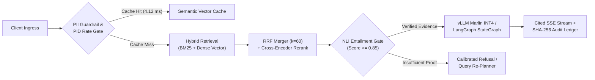

<!-- HERO BANNER (Uses ./assets/banner.svg in Rytnixx786/Rytnixx786) -->

  

<!-- ANIMATED TERMINAL TELEMETRY -->

  

<!-- NAVIGATION & VERIFIED CONTACT LINKS -->

  &nbsp;
  &nbsp;
  &nbsp;
  

---

### `01 // ENGINEERING THESIS & SYSTEM PROFILE`

> **"I care about what happens *after* the model responds."**  
> A language model is only one component of a production system. Real reliability comes from the infrastructure around it: adaptive admission control, hybrid retrieval with calibrated refusal gates, durable state checkpointing, idempotent CI/CD evaluation harnesses, and tamper-evident security boundaries.

<table>
  <tr>
    <td width="54%" valign="top">
      <h4>Core Architectural Focus</h4>
      <ul>
        <li><b>Inference Control & Serving:</b> Self-hosted quantized LLM serving (<code>vLLM</code>, <code>AWQ Marlin INT4</code>), PID concurrency regulation, semantic vector caching, and FinOps token cutoffs.</li>
        <li><b>Evidence-First Retrieval:</b> Hybrid <code>BM25</code> + dense vector search with Reciprocal Rank Fusion (<code>k = 60</code>), cross-encoder reranking, and NLI entailment refusal gates.</li>
        <li><b>Durable Agent Orchestration:</b> Cyclic <code>LangGraph</code> workflows backed by PostgreSQL state checkpointing, human-in-the-loop approval gates, and resumable SSE replay.</li>
        <li><b>Zero-Trust & Offline-First Sync:</b> Multi-tenant PostgreSQL Row-Level Security (RLS), chained <code>SHA-256</code> audit ledgers, and SQLite WAL outbox sync for disconnected environments.</li>
      </ul>
    </td>
    <td width="46%" valign="top">
      <h4>System Diagnostics</h4>
<pre lang="yaml"><code>engineer: "Mehedi Hasan"
location: "Dhaka, Bangladesh (UTC+6)"
education: "B.Sc. in CSE @ BRAC University"
experience:
  - "SWE Intern @ FlyRank (Metering & Billing)"
  - "Independent AI & Backend Systems Builder"
principles:
  - "Evidence first — refuse when proof is missing"
  - "Show the engineering, don't decorate it"
  - "Every model promotion requires a CI gate"</code></pre>
    </td>
  </tr>
</table>

---

### `02 // FLAGSHIP PRODUCTION SYSTEMS`

<table>
  <tr>
    <td width="50%" valign="top">
      <h3>⚡ <a href="https://github.com/Rytnixx786/Cinch">Cinch</a> — LLM Gateway & Serving</h3>
      
14-stage async FastAPI inference gateway & <code>AWQ Marlin INT4</code> serving control plane for <code>Qwen2.5-7B</code> on 8 GB VRAM GPUs with PID admission control, Kubernetes HPA, and FinOps token cutoffs.

      <ul>
        <li><b>10.86×</b> throughput speedup (<b>331 tok/s</b>) & <b>4.87×</b> lower TTFT</li>
        <li><b>4.12 ms</b> semantic cache hits & <b>45 ms</b> circuit-breaker fast-fail</li>
        <li><b>195</b> deterministic CI tests + EBNF/AST JSON grammar repair</li>
      </ul>
      

        <a href="https://github.com/Rytnixx786/Cinch"><code>Source ↗</code></a> ·
        <a href="https://mehedi-hasan-llm.vercel.app/work/cinch"><code>Case Study ↗</code></a> ·
        <code>Python</code> <code>FastAPI</code> <code>vLLM</code> <code>K8s</code> <code>Prometheus</code>
      

    </td>
    <td width="50%" valign="top">
      <h3>🕸️ <a href="https://github.com/Rytnixx786/Nexus">Nexus Researcher</a> — Agentic Workflow</h3>
      
Deterministic 8-node <code>LangGraph</code> deep-research engine with 4-stage hybrid retrieval, human-in-the-loop approval gates, PostgreSQL checkpointing, and resumable SSE streaming.

      <ul>
        <li><b>8.05 req/s</b> sustained load with durable PostgreSQL state recovery</li>
        <li><b>91%</b> adversarial refusal accuracy on sparse/conflicting evidence</li>
        <li><b>122</b> backend test suites passing with Redis token-bucket rate limits</li>
      </ul>
      

        <a href="https://github.com/Rytnixx786/Nexus"><code>Source ↗</code></a> ·
        <a href="https://mehedi-hasan-llm.vercel.app/work/nexus-researcher"><code>Case Study ↗</code></a> ·
        <code>LangGraph</code> <code>FastAPI</code> <code>pgvector</code> <code>Redis</code> <code>React</code>
      

    </td>
  </tr>
  <tr>
    <td width="50%" valign="top">
      <h3>🛡️ <a href="https://github.com/Rytnixx786/Ares">ARES</a> — MLOps Promotion Gate</h3>
      
Idempotent model reliability, drift detection, and regression-gating platform evaluating candidate builds against golden sets and live champions directly in CI/CD.

      <ul>
        <li><b>92%+</b> enforced test coverage across <b>72</b> test modules (<code>~420</code> tests)</li>
        <li>Configurable F1, latency, KS/PSI drift, and demographic slice gates</li>
        <li>Async SQLAlchemy + PostgreSQL decision trail, Celery workers & Streamlit UI</li>
      </ul>
      

        <a href="https://github.com/Rytnixx786/Ares"><code>Source ↗</code></a> ·
        <a href="https://mehedi-hasan-llm.vercel.app/work/ares"><code>Case Study ↗</code></a> ·
        <code>Python</code> <code>FastAPI</code> <code>SQLAlchemy</code> <code>DVC</code> <code>MLflow</code>
      

    </td>
    <td width="50%" valign="top">
      <h3>🧠 <a href="https://github.com/Rytnixx786/MindStack">MindStack</a> — Calibrated Hybrid RAG</h3>
      
Evidence-first retrieval platform combining sparse lexical matching (<code>BM25</code>) and dense embeddings (<code>ChromaDB</code>) with cross-encoder reranking to eliminate ungrounded synthesis.

      <ul>
        <li><b>95%</b> QA groundedness via Reciprocal Rank Fusion (<code>k = 60</code>)</li>
        <li>Boosted adversarial refusal accuracy from <b>26.7% → 66.7%</b></li>
        <li>Parent-child document chunking + pre-generation NLI entailment gate</li>
      </ul>
      

        <a href="https://github.com/Rytnixx786/MindStack"><code>Source ↗</code></a> ·
        <a href="https://mehedi-hasan-llm.vercel.app/work/mindstack"><code>Case Study ↗</code></a> ·
        <code>FastAPI</code> <code>ChromaDB</code> <code>BM25</code> <code>Ragas</code> <code>React</code>
      

    </td>
  </tr>
  <tr>
    <td width="50%" valign="top">
      <h3>🔒 <a href="https://github.com/Rytnixx786/OFF-Boarder">OFFBoarder</a> — Zero-Trust SaaS</h3>
      
Multi-tenant enterprise offboarding platform automating access revocation with strict database-level tenant isolation, Risk Radar telemetry, and tamper-evident audit ledgers.

      <ul>
        <li>PostgreSQL RLS session isolation + Segregation of Duties (<code>Creator ≠ Approver</code>)</li>
        <li>Chained <b>SHA-256</b> cryptographic audit logs & transactional outbox retries</li>
        <li>Real-time revocation workflows across identity, cloud, and hardware assets</li>
      </ul>
      

        <a href="https://github.com/Rytnixx786/OFF-Boarder"><code>Source ↗</code></a> ·
        <a href="https://mehedi-hasan-llm.vercel.app/work/offboarder"><code>Case Study ↗</code></a> ·
        <code>Next.js 16</code> <code>TypeScript</code> <code>Prisma</code> <code>Supabase RLS</code>
      

    </td>
    <td width="50%" valign="top">
      <h3>🩺 <a href="https://github.com/DigontaDas/MaSheba--AI">MaSheba AI</a> — Offline-First Clinical Sync</h3>
      
Bangla maternal healthcare & on-device risk triage platform engineered for rural community health workers operating in zero-connectivity zones.

      <ul>
        <li>Local SQLite WAL outbox queue with microsecond logical-clock conflict resolution</li>
        <li>On-device <code>ONNX</code> risk scoring, resumable media sync & Bangla voice RAG</li>
        <li>3-portal ecosystem: Expo mobile app, FastAPI backend, and PostGIS admin map</li>
      </ul>
      

        <a href="https://github.com/DigontaDas/MaSheba--AI"><code>Source ↗</code></a> ·
        <a href="https://mehedi-hasan-llm.vercel.app/work/masheba-ai"><code>Case Study ↗</code></a> ·
        <a href="https://masheba-docs.vercel.app/docs"><code>Docs ↗</code></a> ·
        <code>Expo</code> <code>ONNX</code> <code>FastAPI</code> <code>PostGIS</code>
      

    </td>
  </tr>
</table>

---

### `03 // ADDITIONAL SYSTEMS, INFRASTRUCTURE & RESEARCH`

| System / Repository | Architectural Domain | Key Engineering Highlights | Stack |
| :--- | :--- | :--- | :--- |
| **[flyrank-capstone-metering-billing](https://github.com/Rytnixx786/flyrank-capstone-metering-billing)** | Multi-Tenant Usage Metering & Stripe Billing | Idempotent usage event ingestion, tiered pricing calculation engine, and asynchronous Stripe webhook state reconciliation. | `FastAPI` `SQLAlchemy 2` `Stripe SDK` `Pydantic v2` |
| **[celloscope-assessment](https://github.com/Rytnixx786/celloscope-assessment)** | Clinical Speech & Lab Report Extraction | Strict 3-layer clean architecture (`api` / `services` / `adapters`), deterministic zero-credential mock mode, and `25` contract & layer-isolation tests. | `Python 3.11` `FastAPI` `Pydantic v2` `Docker` `Pytest` |
| **[autonomous-security-ai](https://github.com/Rytnixx786/autonomous-security-ai)** | Self-Learning Cyber-Defense Agent | Streaming telemetry anomaly detection with adaptive policy enforcement and human analyst feedback recalibration loop. | `Python` `scikit-learn` `Typer CLI` `Pydantic` |
| **[my-portfolio-website](https://github.com/Rytnixx786/my-portfolio-website)** | Interactive Engineering Portfolio & Case Studies | Deep-dive system architecture case studies, interactive architecture graph inspector, and Gemini-backed system query route. | `Next.js 16` `React 19` `TypeScript 5` `Tailwind 4` |
| **Clinical 3D CCTA & OS Kernel Work** | Volumetric Medical AI & Low-Level Systems | **3D CCTA Coronary Stenosis Engine** (`RASNet` + `SegResNet`, **95.2%** adjacent CAD-RADS agreement), **SimpleFS** (custom C file system with superblocks & inode tables), and a **RISC-V `xv6` Lottery Scheduler**. | `PyTorch 3D` `C` `POSIX` `RISC-V xv6` |

---

### `04 // REFERENCE ARCHITECTURE & MEASURED BENCHMARKS`

How my production AI pipelines enforce deterministic quality, latency, and safety boundaries before streaming a single token to the client:

<b>📊 View Verified Engineering Benchmark Summary (Click to Expand)</b>

 

| System | Evaluated Metric | Baseline / Unoptimized | Engineered Result | Verification Context |
| :--- | :--- | :--- | :--- | :--- |
| **[Cinch](https://github.com/Rytnixx786/Cinch)** | Generation Throughput & TTFT | `30.48 tok/s` (`FP16` baseline) | **`331.0 tok/s` (`10.86×`) · `4.87×` lower TTFT** | `Qwen2.5-7B-Instruct` AWQ Marlin INT4 on 8 GB VRAM GPU + `195` CI tests |
| **[Cinch](https://github.com/Rytnixx786/Cinch)** | Cache Hit & Fast-Fail Latency | Full LLM round-trip (`>1,200 ms`) | **`4.12 ms` cache hit · `45 ms` breaker trip** | Redis semantic cache + sliding-window circuit breaker |
| **[Nexus Researcher](https://github.com/Rytnixx786/Nexus)** | Adversarial Refusal & Load | Unchecked single-pass RAG | **`91%` refusal accuracy · `8.05 req/s` load** | 8-node LangGraph + PostgreSQL checkpointing + `122` backend tests |
| **[MindStack](https://github.com/Rytnixx786/MindStack)** | Groundedness & Refusal Rate | `26.7%` refusal on unanswerable queries | **`95%` groundedness · `66.7%` refusal accuracy** | Hybrid BM25 + ChromaDB (`RRF k=60`) + NLI pre-generation gate |
| **[ARES](https://github.com/Rytnixx786/Ares)** | Automated Regression Gate Coverage | Ad-hoc notebook checks | **`92%+` enforced coverage (`~420` tests)** | 7 GitHub Actions workflows + unit, integration, contract & property tests |

---

### `05 // PRODUCTION STACK BY ARCHITECTURAL LAYER`

  

    
  

<table>
  <tr>
    <td width="28%"><b>Languages & Systems</b></td>
    <td width="72%">
      
      
      
      
      
      
    </td>
  </tr>
  <tr>
    <td><b>LLM Serving, RAG & ML</b></td>
    <td>
      
      
      
      
      
    </td>
  </tr>
  <tr>
    <td><b>Backend & Distributed APIs</b></td>
    <td>
      
      
      
      
      
    </td>
  </tr>
  <tr>
    <td><b>Data, Vector & Edge Storage</b></td>
    <td>
      
      
      
      
      
    </td>
  </tr>
  <tr>
    <td><b>Frontend & Mobile Surfaces</b></td>
    <td>
      
      
      
      
      
    </td>
  </tr>
  <tr>
    <td><b>MLOps, Cloud & Observability</b></td>
    <td>
      
      
      
      
      
    </td>
  </tr>
</table>

---

### `06 // TELEMETRY & ACTIVITY`

  <picture>
    <source media="(prefers-color-scheme: dark)" srcset="https://github-stats-extended.vercel.app/api?username=Rytnixx786&show_icons=true&hide_border=true&bg_color=0d1117&title_color=10b981&icon_color=10b981&text_color=c9d1d9" />
    <source media="(prefers-color-scheme: light)" srcset="https://github-stats-extended.vercel.app/api?username=Rytnixx786&show_icons=true&hide_border=true&bg_color=ffffff&title_color=0f766e&icon_color=10b981&text_color=1f2937" />
    
  </picture>
  <picture>
    <source media="(prefers-color-scheme: dark)" srcset="https://streak-stats.demolab.com?user=Rytnixx786&hide_border=true&background=0D1117&ring=10B981&fire=10B981&currStreakLabel=10B981&sideLabels=C9D1D9&currStreakNum=FFFFFF&sideNums=FFFFFF&dates=8B949E" />
    <source media="(prefers-color-scheme: light)" srcset="https://streak-stats.demolab.com?user=Rytnixx786&hide_border=true&background=FFFFFF&ring=0F766E&fire=10B981&currStreakLabel=0F766E&sideLabels=1F2937&currStreakNum=0F172A&sideNums=0F172A&dates=6B7280" />
    
  </picture>

---

  Built with deterministic systems discipline · <a href="https://mehedi-hasan-llm.vercel.app/"><b>mehedi-hasan-llm.vercel.app</b></a> · <a href="mailto:nafismehedi37@gmail.com"><b>nafismehedi37@gmail.com</b></a>

