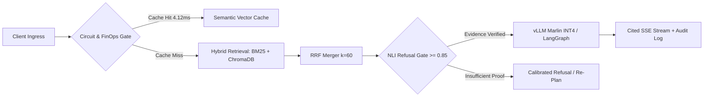

<!-- TOP STATUS PILL -->

  

<!-- NATIVE CRISP HERO TITLE (Zero external server dependency) -->
<h1 align="center">
  Mehedi Hasan
   
  AI Systems Engineer &nbsp;·&nbsp; RAG & Agentic Architect &nbsp;·&nbsp; Backend & MLOps
</h1>

<!-- BLOCK-WRAPPED ANIMATED TERMINAL LINE -->

  

<!-- UNIFIED SINGLE-ROW NAVIGATION BAR -->

  &nbsp;
  &nbsp;
  

---

### `01 // ENGINEERING PHILOSOPHY`

> **"I care about what happens *after* the model responds."**  
> Shipping AI into production means refusing uncalibrated hallucinations, replacing brittle prompt loops with stateful graph checkpoints, and gating every model promotion behind deterministic CI benchmarks.

<table>
  <tr>
    <td width="56%" valign="top">
      <h4>Core Architectural Focus</h4>
      <ul>
        <li><b>Inference & FinOps:</b> Self-hosted quantized serving (<code>vLLM</code>, <code>AWQ Marlin INT4</code>), semantic vector caching, and token budget cutoffs.</li>
        <li><b>Calibrated Retrieval:</b> Hybrid <code>BM25</code> + dense vector search with Reciprocal Rank Fusion and NLI entailment refusal gates.</li>
        <li><b>Durable Orchestration:</b> Stateful <code>LangGraph</code> workflows backed by PostgreSQL checkpointing and resumable SSE streams.</li>
        <li><b>Security & Edge Sync:</b> Multi-tenant PostgreSQL RLS, chained <code>SHA-256</code> audit ledgers, and offline-first SQLite outbox sync.</li>
      </ul>
    </td>
    <td width="44%" valign="top">
      <h4>System Telemetry</h4>
      <ul>
        <li><b>Base:</b> Dhaka, Bangladesh (<code>UTC+6</code>)</li>
        <li><b>Experience:</b> SWE Intern @ <b>FlyRank</b> · Independent AI Systems Builder</li>
        <li><b>Education:</b> B.Sc. in CSE @ <b>BRAC University</b></li>
        <li><b>Clinical AI Research:</b> 3D CCTA Coronary Stenosis & QCA Engine (<code>RASNet</code> / <code>SegResNet</code> · <b>95.2%</b> adjacent CAD-RADS agreement)</li>
        <li><b>Kernel & OS Work:</b> Custom C File System (<code>SimpleFS</code>) & RISC-V <code>xv6</code> Lottery Scheduler</li>
      </ul>
    </td>
  </tr>
</table>

### `02 // FLAGSHIP PRODUCTION SYSTEMS`

<table>
  <tr>
    <td width="50%" valign="top">
      <h3>⚡ <a href="https://mehedi-hasan-llm.vercel.app/work/cinch">Cinch</a> — LLM Gateway & Serving</h3>
      
14-stage async FastAPI gateway & INT4 Marlin serving platform for Qwen2.5-7B on 8GB VRAM GPUs with Kubernetes HPA and FinOps token cutoffs.

      <ul>
        <li><b>10.86×</b> throughput speedup (<b>331 tok/s</b>) & <b>4.87×</b> lower TTFT</li>
        <li><b>4.12ms</b> semantic cache hits & <b>45ms</b> circuit-breaker fast-fail</li>
        <li><b>195</b> deterministic CI tests + EBNF/AST JSON grammar repair</li>
      </ul>
      

        <a href="https://mehedi-hasan-llm.vercel.app/work/cinch"><code>Case Study ↗</code></a> ·
        <code>Python</code> <code>FastAPI</code> <code>vLLM</code> <code>K8s</code> <code>Prometheus</code>
      

    </td>
    <td width="50%" valign="top">
      <h3>🕸️ <a href="https://github.com/Rytnix786/Nexus">Nexus Researcher</a> — Agentic Workflow</h3>
      
Deterministic 8-node LangGraph research engine featuring four-stage retrieval, human-in-the-loop approval gates, and resumable SSE streaming.

      <ul>
        <li><b>8.05 req/s</b> sustained load with PostgreSQL state checkpointing</li>
        <li><b>91%</b> adversarial refusal accuracy on sparse/conflicting evidence</li>
        <li><b>122</b> backend test suites passing with Redis token-bucket rate limiting</li>
      </ul>
      

        <a href="https://github.com/Rytnix786/Nexus"><code>Source ↗</code></a> ·
        <a href="https://mehedi-hasan-llm.vercel.app/work/nexus-researcher"><code>Case Study ↗</code></a> ·
        <code>LangGraph</code> <code>FastAPI</code> <code>PostgreSQL</code> <code>Redis</code>
      

    </td>
  </tr>
  <tr>
    <td width="50%" valign="top">
      <h3>🛡️ <a href="https://github.com/Rytnix786/Ares">ARES</a> — MLOps Promotion Gate</h3>
      
Idempotent model regression detection framework evaluating candidate builds against golden sets and live champions directly in CI/CD.

      <ul>
        <li><b>92%+</b> enforced pytest coverage keyed by commit SHA & dataset version</li>
        <li>Configurable F1, latency, and demographic critical-slice gates</li>
        <li>Async SQLAlchemy + PostgreSQL decision trail & Streamlit operator UI</li>
      </ul>
      

        <a href="https://github.com/Rytnix786/Ares"><code>Source ↗</code></a> ·
        <a href="https://mehedi-hasan-llm.vercel.app/work/ares"><code>Case Study ↗</code></a> ·
        <code>Python 3.11</code> <code>SQLAlchemy</code> <code>DVC</code> <code>Docker</code>
      

    </td>
    <td width="50%" valign="top">
      <h3>🧠 <a href="https://mehedi-hasan-llm.vercel.app/work/mindstack">MindStack</a> — Calibrated Hybrid RAG</h3>
      
Evidence-first retrieval pipeline combining sparse lexical matching and dense embeddings to eliminate ungrounded synthesis.

      <ul>
        <li><b>95%</b> QA groundedness via Reciprocal Rank Fusion (<code>k = 60</code>)</li>
        <li>Boosted adversarial refusal accuracy from <b>26.7% → 66.7%</b></li>
        <li>Parent-child chunking + pre-generation NLI entailment gate</li>
      </ul>
      

        <a href="https://mehedi-hasan-llm.vercel.app/work/mindstack"><code>Case Study ↗</code></a> ·
        <code>FastAPI</code> <code>ChromaDB</code> <code>BM25</code> <code>Mistral</code> <code>React</code>
      

    </td>
  </tr>
  <tr>
    <td width="50%" valign="top">
      <h3>🔐 <a href="https://mehedi-hasan-llm.vercel.app/work/offboarder">OFFBoarder</a> — Zero-Trust SaaS</h3>
      
Multi-tenant enterprise offboarding platform automating access revocation with strict database-level isolation and tamper-proof security ledgers.

      <ul>
        <li>PostgreSQL RLS session isolation + Segregation of Duties (Creator ≠ Approver)</li>
        <li>Chained <b>SHA-256</b> cryptographic audit logs & transactional outbox retries</li>
      </ul>
      

        <a href="https://mehedi-hasan-llm.vercel.app/work/offboarder"><code>Case Study ↗</code></a> ·
        <code>Next.js</code> <code>TypeScript</code> <code>Prisma</code> <code>PostgreSQL</code> <code>Supabase</code>
      

    </td>
    <td width="50%" valign="top">
      <h3>🏥 <a href="https://mehedi-hasan-llm.vercel.app/work/masheba-ai">MaSheba AI</a> — Offline-First Clinical Sync</h3>
      
Bangla maternal healthcare & triage platform engineered for rural community health workers operating in zero-connectivity zones.

      <ul>
        <li>Local SQLite outbox queue with microsecond logical-clock conflict resolution</li>
        <li>Resumable byte-offset media uploads & Bangla NLP clinical triage</li>
      </ul>
      

        <a href="https://mehedi-hasan-llm.vercel.app/work/masheba-ai"><code>Case Study ↗</code></a> ·
        <code>React Native</code> <code>Expo</code> <code>SQLite</code> <code>FastAPI</code> <code>Supabase</code>
      

    </td>
  </tr>
</table>

> **Systems & Kernel Foundations:** Also engineered **3D CCTA Stenosis Quantification** (`RASNet` + `SegResNet` 4-stage 3D encoder across clinical cardiac scans), **SimpleFS** (custom C file system with superblocks & inode tables), and a **RISC-V xv6 Lottery Scheduler** inside the OS kernel.

---

### `03 // REFERENCE ARCHITECTURE`

How my production AI pipelines enforce deterministic quality boundaries before a single token streams to the client:

---

### `04 // PRODUCTION STACK`

  

    
  

<table>
  <tr>
    <td width="28%"><b>Languages & Systems</b></td>
    <td width="72%">
      
      
      
      
      
      
    </td>
  </tr>
  <tr>
    <td><b>LLM, RAG & Deep Learning</b></td>
    <td>
      
      
      
      
      
      
    </td>
  </tr>
  <tr>
    <td><b>Backend & Distributed APIs</b></td>
    <td>
      
      
      
      
      
    </td>
  </tr>
  <tr>
    <td><b>Data, Vector & Edge Storage</b></td>
    <td>
      
      
      
      
      
    </td>
  </tr>
  <tr>
    <td><b>Frontend & Cross-Platform</b></td>
    <td>
      
      
      
      
      
    </td>
  </tr>
  <tr>
    <td><b>MLOps, Cloud & Observability</b></td>
    <td>
      
      
      
      
      
      
      
    </td>
  </tr>
</table>

### `05 // TELEMETRY & ACTIVITY`

<!-- Note: Swap username=Rytnixx786 to username=Rytnix786 below if deploying on your single-x handle -->

  <picture>
    <source media="(prefers-color-scheme: dark)" srcset="https://github-stats-extended.vercel.app/api?username=Rytnixx786&show_icons=true&hide_border=true&bg_color=0d1117&title_color=10b981&icon_color=10b981&text_color=c9d1d9" />
    <source media="(prefers-color-scheme: light)" srcset="https://github-stats-extended.vercel.app/api?username=Rytnixx786&show_icons=true&hide_border=true&bg_color=ffffff&title_color=0f766e&icon_color=10b981&text_color=1f2937" />
    
  </picture>
  <picture>
    <source media="(prefers-color-scheme: dark)" srcset="https://streak-stats.demolab.com?user=Rytnixx786&hide_border=true&background=0D1117&ring=10B981&fire=10B981&currStreakLabel=10B981&sideLabels=C9D1D9&currStreakNum=FFFFFF&sideNums=FFFFFF&dates=8B949E" />
    <source media="(prefers-color-scheme: light)" srcset="https://streak-stats.demolab.com?user=Rytnixx786&hide_border=true&background=FFFFFF&ring=0F766E&fire=10B981&currStreakLabel=0F766E&sideLabels=1F2937&currStreakNum=0F172A&sideNums=0F172A&dates=6B7280" />
    
  </picture>

---

  Built with deterministic systems discipline · <a href="https://mehedi-hasan-llm.vercel.app/"><b>mehedi-hasan-llm.vercel.app</b></a>

